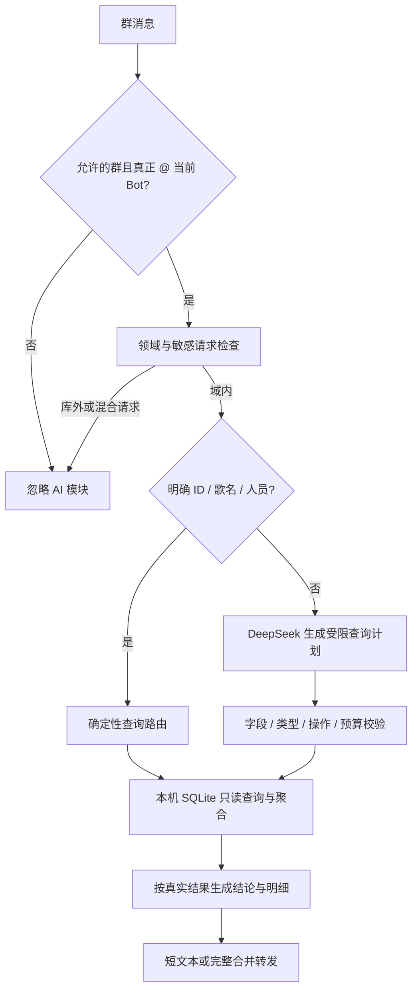

# 近期迭代与工程案例

更新日期：2026-10-21。范围：2026-09 公开快照之后的内部项目迭代。

本页用于展示产品思路、工程取舍和验证方法，**不是新版客户端的发布公告**。本次只更新文档，不同步内部业务源码、运行配置、真实曲库、群号、日志、PSD、字体或发行包。公开代码与历史体验包的能力以仓库内实际实现为准。

## 1. 数据库驱动的曲库 AI Agent

### 用户问题与产品目标

传统 `!ID`、关键词命令适合精确查歌，但难以表达“某两位谱师谁的作品更多”“其中高难度作品谁更多”“两年分别发布多少首歌”等组合需求。目标不是开放闲聊，而是让用户以自然语言完成现有曲库的查询、筛选、关联和比较。

### 实际链路

**模型负责理解，程序负责事实。** 简单查询不调用模型；复杂问法通过一次意图解析构造受限计划。模型不能执行任意 SQL、代码、文件访问、网络搜索或写库，也不接收整库和查询结果去自由改写事实。密钥只在认证层使用，不进入提示词、结果或回复。

### 已实现的自然语言范围

- 歌曲、谱面、专辑三个视图，以及茶韵/Stable 数据源选择；精确人员成员匹配，区分歌名、别名、曲师和谱师。
- 难度、键数、BPM、时长、发布日期等条件筛选；计数、分组、排序、最小/最大/平均/合计。
- 双人作品量、差值与比例，交集/并集/差集，合作与任一参与；统计后关联作品明细。
- 同一消息的多个问题、年份/月分枚举、多个比较条件；保留每个子问题的结果而非只回答第一项。
- 专辑编号查询、歌曲所属专辑、日期关联；仅在专辑日期唯一一致且归属明确时解析缺失日期，冲突不猜测、不回填数据库。
- 返回完整匹配结果；用户明确要求前 N 名时才限制，最高项并列保留。长结果采用传输分段的合并转发，不要求用户“虚拟翻页”。

代表性验收问法（非固定触发模板）：

| 问法 | 隐含的数据操作 |
| --- | --- |
| 谱师甲和谱师乙谁的作品更多？谁的 13 级以上作品更多？ | 分人统计 + 谱面条件过滤 + 两组独立比较 |
| 2025 和 2026 年分别发布了多少首歌？ | 分解年份区间 + 使用同一日期语义计数 |
| 这首歌在哪个专辑，什么时候发布？ | 定位歌曲 + 关联专辑 + 一致性校验后的日期解析 |
| 两位谱师共同参与的作品有哪些？ | 按完整署名成员计算交集，不做名字子串匹配 |

### 不越界的规则

只在指定群的真实 @ 消息中启用；其他群、私聊、库外及混合请求不进入回答流程。现有查询可见性规则仍生效，不能借 AI 绕过权限。Stable 没有的字段不能当作零值，未收录难度不能从其他档位猜测；署名不等于知道每个合作者具体负责哪张谱面。

采用限流、有界队列、只读连接和纯文本输出，数据库内容不能被解释成 QQ 控制指令。未配置模型或模型不可用时，明确查询仍可直接读库；解析失败与数据库故障分开提示。没有长期对话记忆，也不承诺理解任意自然语言。

**状态：** 内部已有单群灰度部署记录；真实群聊体验仍需人工验收，本次没有重新部署或自动发送 QQ 消息。相关实现未并入公开快照。

## 2. 从 PSD 到可编辑的海报工作流

### 不是一张扁平背景图

将原设计拆解为背景、固定装饰、歌曲行、曲绘裁切、文字、人物贴图和底部区域，保留图层顺序、透明度、字体与坐标规则，再通过 Java 画布实现可编辑区域。固定装饰与可变业务字段分离，避免每次发布都重新操作 PSD。

| 模板 | 可编辑能力与约束 |
| --- | --- |
| Muse Dash | 五/六曲长海报；五曲版移除末行但保留底部文字和 Logo |
| 术力口 | 五/六曲；每行独立选择歌姬，使用常见显示名；支持外部 PNG 导入、人物区域左键横向拖动 |
| 百鬼夜行、东方不眠夜 | 五/六曲；沿用各自原生裁切、文字和装饰布局 |
| 炫彩之音 | 五/六曲；文字后半透明图片可独立替换，也可重新跟随曲绘，不与整张海报背景混为一项 |
| 唱片轮换 | 双专辑图与可替换背景；标题、说明、Logo 等固定，仅日期字段可改并校验合法性 |

统一交互为 **Ctrl + 滚轮缩放画布，普通滚轮/空白区域左键拖动浏览**，角色区域拖动优先调整人物，不与画布浏览冲突。裁切对话框以窗口为定位基准；`.tea` 工程内嵌导入图片与编辑状态，不依赖原电脑文件路径。

模板字体按原设计的字体资源匹配；缺失资源明确报错，不能悄悄换成系统字体后声称完全还原。素材提取工具与模板、字体、人物位置回归已经进入内部工程；自动渲染检查不等于用户视觉验收。受授权限制的原素材不公开。

工作站交互也补充了歌曲 ID 默认首列、列可拖动、Stable 默认时间排序，以及资源更换/取消/保存/删除的按钮分组与粉色主次层级；不为界面美化改动谱面计算语义。

## 3. 可靠性：成功不是一个布尔值

### 案例一：新电脑歌曲列表空白，Stable 却正常

**原因：** 旧仓储层用“SQLite 文件存在且非零字节”判断可用性，但初始化空表同样满足条件。查询成功返回零行，挡住了云端完整曲库，刷新也只重复同一路径。

**改进：** 只读检查必要表字段和实际数据；空库、坏库或缺表时回退云端。原本有数据的本地库变空也会回退，页面提示当前来源。独立本地模式仍允许真正的空库，不通过自动检查向空本地库灌入生产数据。

**证据：** 隔离复现中，修复前歌曲 0 条、Stable 1 条，修复后两者均 1 条；覆盖缺文件、空库、缺字段、损坏、健康库及运行中清空。没有直接读取反馈者电脑，不能声称已远程验证他的实际环境。

### 案例二：更换一张曲绘却等待整库发布

**原因：** 主工作站的资源更换曾耦合内部 Python 整库处理、云端发布和 GitHub 备份。外部网络超时时，一部分操作可能已经完成；笼统报“失败、已恢复”会掩盖云端与本地状态不同。

**改进：** 有云客户端的交互路径统一执行“核对单曲 → 获取签名地址 → 上传 → 登记 → 权威回读 → 同步本地副本”，不等待整库压缩或 GitHub 推送。既有后台整库发布保留，但不阻塞单曲按钮。

| 观察到的状态 | 对用户的反馈与恢复策略 |
| --- | --- |
| 上传前或登记前明确失败 | 中文解释失败环节，保留原本地素材 |
| 登记已提交但响应丢失，或回读超时 | 结果待确认；不宣称已回滚，不盲目重复创建 |
| 云端回读确认成功 | 明确已更新，再同步本机媒体、CSV/SQLite |
| 云端成功但本地同步失败 | 显示局部警告，保留备份并改读云端，不撤销已确认的远端结果 |

单曲回归覆盖歌曲图、专辑图、音频、本地/便携两种环境，以及上传失败、响应丢失、回读失败、本地副本失败、ID 不存在等九种情形。断言不仅检查异常，还检查字节、调用次数和不应发生的整库操作。

**状态：** 上述两个最新修复属于 v1.1.52 本地测试候选，已构建并通过隔离回归，尚未批准正式发布。没有上传真实素材、改变代理设置，也未自动修复历史操作产生的数据差异。

### 其他已纳入内部回归的故障类型

- MCZ 导入中的子进程超时、输出读取与队列恢复：一个异常文件不能让后续导入永久等待。
- 新歌媒体先暂存再提交元数据，区分文字已保存、媒体未完成和结果未确认；同 ID 重试先核对身份，不能把不同歌曲互相覆盖。
- 删除云端已经成功但本地镜像失败时报告部分结果，避免“报删除失败，重开却消失”的歧义。
- 公告正文与附件部分成功、领取任务与完成回报、重试及中文错误脱敏；这些隔离检查不证明真实定时发送永不失败。
- NapCat 进程、QQ 接口在线和真实消息收发证据分层；“连接设置”不以 QQ 已在线为前置条件，管理服务未启动则不能保证登录页可访问。

## 4. 自动测试与发布门禁

### 分层而不是只安装测试工具

| 层级 | 作用 | 关键断言 |
| --- | --- | --- |
| pytest | 发布脚本规则、参数化、编排选定 Node/Java 回归及报告 | 版本冲突零写入、上传中断不推进清单、摘要与实际字节一致 |
| JUnit 5 | Java 参数、异常、版本规则和提示脱敏 | 数字版本比较、错误原因保留、凭据不能进入提示 |
| Java/Node 既有回归 | 调用真实业务入口，外部服务用 Fake/回环 HTTP 替代 | CRUD、媒体挂接、幂等、部分失败、鉴权和错误恢复 |
| 打包运行时门禁 | 用随包 Java 再执行指定无界面测试 | 防止只在开发环境通过、最终包缺依赖 |
| 人工验收 | 测试客户端真实操作体验及获准的收发检查 | 不把模拟成功当作真实 QQ 验收，也不自动向生产库造测试数据 |

方法是先让正确的回归测试在旧实现上变红，再修业务代码转绿，最后复查相关路径。Mock/Fake 只替代外部依赖，不能把待测规则一起替换后自证成功。

**2026-10-21 验证记录：** 内部组合 pytest 为 **43 passed**，其中嵌套执行 JUnit **17 项**，不能相加宣称 60 项独立测试；另外完成相关回归和完整本地构建，新增两组回归也在打包运行时通过。该数字不是本公开仓库 GitHub Actions 的结果，不是覆盖率，更不是真实生产端到端通过率。

### 可追溯候选

1. 修改只进入内部本地测试树；客户端程序、缓存与构建产物独立。
2. 隔离测试只使用临时库、虚构素材和回环服务。交互测试客户端共用真实业务数据，两者不能混用。
3. 构建记录源码、JAR、安装包 SHA-256；任一代码变化使原候选失效，必须重建。
4. 人工验收并批准确切候选后，先本机独立版本目录安装、校验装出内容，再上传公开更新并同步入口。
5. 安装、公共上传和本机入口同步分别记录结果；上传已确认时可只重试本机同步，不重复发布。版本冲突在安装/上传前拦截。

这使“测试通过”“允许发布”“云端发布完成”“本机切换完成”成为独立事实，而不是一条模糊的“更新成功”。本次作品文档更新不触发上述客户端发布。

## 5. 实现与证据索引

以下是**内部工程的类/工具名称**，供解释实现分工；它们不是本公开快照中的可点击源码或可直接运行命令。本次没有把内部目录复制到公开仓库。

| 方向 | 内部实现/验证入口 |
| --- | --- |
| Agent 领域与消息门禁 | `LibraryAiAgent`、`LibraryAiAgentRegressionTest`、`AiLibraryPersonRegressionTest` |
| 只读计划与语义关系 | `AiLibraryQuery`、`AiLibraryDates`、`AiLibraryRelationsRegressionTest`、`AiLibraryMultiQuestionRegressionTest`、`AiLibraryAlbumDateRegressionTest` |
| 长回复与模型最小化 | `AiLibraryFullReplyRegressionTest`；真实模型专项测试仅用虚构曲库，需显式允许付费 API |
| PSD 图层与主题模板 | `Md4Poster`、`VocaloidPoster`、`ThemedPoster`、`RotationPoster`、`SingerLibrary`，配套图层提取与模板/字体/人物位置回归 |
| 曲库与素材 | `SongLibraryRepository`、`CloudLibraryClient`、`SongAssetService`、`CloudLibraryEmptyLocalRegressionTest`、`SongAssetSingleSongRegressionTest` |
| 测试与发布 | `test.ps1`、`test-java.ps1`、`build.ps1`、`gate.ps1`、`promote.ps1`；源码/JAR/安装包绑定候选清单 |

## 6. 从产品到工程的取舍

- **Agent 不等于通用聊天：** 业务边界越清晰，数据可核验、权限可控和成本可预测越容易实现。
- **复用确定性能力：** 简单需求直接查库，模型只解决语言到操作的映射；不把所有请求都交给 API。
- **模板不是截图：** 通过可编辑图层和工程文件降低重复劳动，而非为每个主题新建一套孤立操作流程。
- **反馈对应真实状态：** 能看懂的错误必须说明失败环节、是否已经生效，以及用户下一步怎么做。
- **先证明再发布：** 本地测试、哈希门禁、隔离数据和人工验收共同约束更新；不把暂未实现或未验收的目标写成上线成果。
